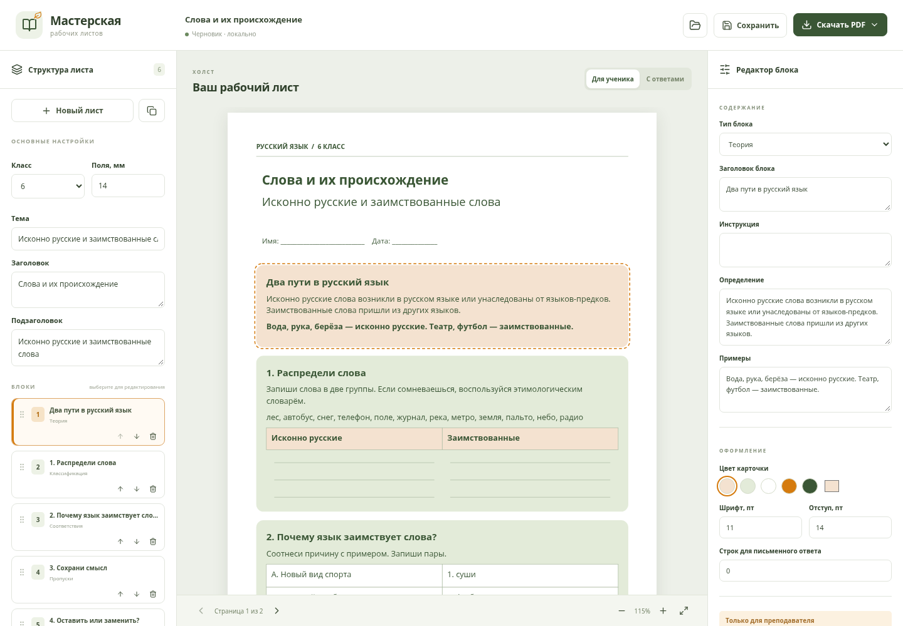

# Мастерская рабочих листов

Работающий визуальный редактор рабочих листов по русскому языку для 5–9 классов: React + TypeScript, страницы А4, векторный PDF с кириллицей, локальные проекты и отдельные ответы преподавателя.



## Открыть локально

Установите Node.js 22 или новее. В скачанном репозитории выполните:

```bash
cd workshop
npm ci
npm run dev
```

Откройте адрес из терминала (обычно `http://localhost:5173`). Начальный демонстрационный лист содержит теорию и пять разных заданий. Создайте собственный через **Новый лист**, редактируйте карточки справа и скачайте PDF кнопкой вверху.

[Полная инструкция, сохранение и публикация](workshop/README.md).

## Открыть как обычный сайт

Готовая сборка находится в ветке **workshop-site**. В GitHub включите **Settings → Pages → Deploy from a branch → workshop-site → /(root)**. После публикации приложение открывается по адресу `https://yaksyusok-byte.github.io/lesson/`. Само создание ветки не включает GitHub Pages.

## Что проверено

6 тестов раскладки и 4 браузерных сценария: все 12 типов блоков, длинные тексты и ячейки, сохранность формулировок, отсутствие ключей в ученическом PDF, изменение пяти демонстрационных заданий, таблицы, сохранение/открытие/дублирование, JSON и реальные скачивания PDF. Браузерные сценарии выполнены в Chromium.

[Примеры экспортированных PDF](workshop/examples/).

Без ИИ приложение не имитирует генерацию: теория сохраняется как авторский блок. Проекты хранятся локально, регистрация не требуется. JSON содержит и ответы, поэтому ученику передавайте ученический PDF.

Ранее созданные печатные материалы сохранены в [results](results/).
